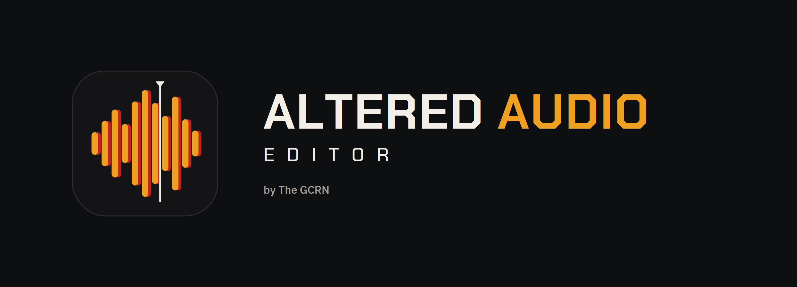
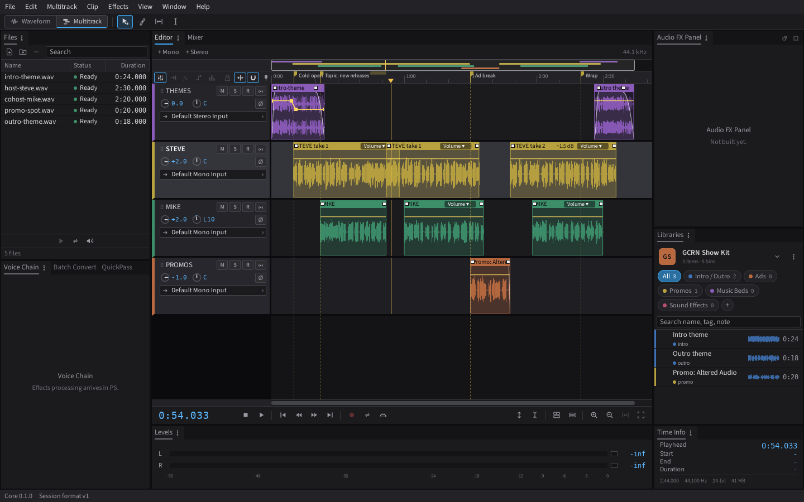
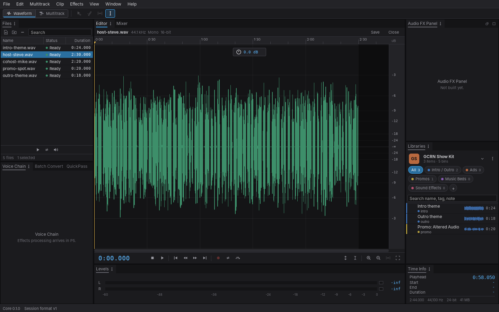
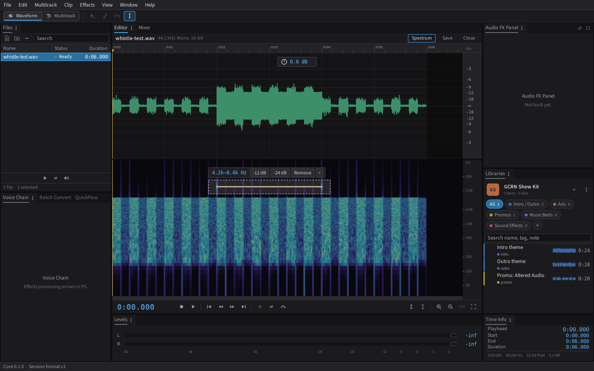
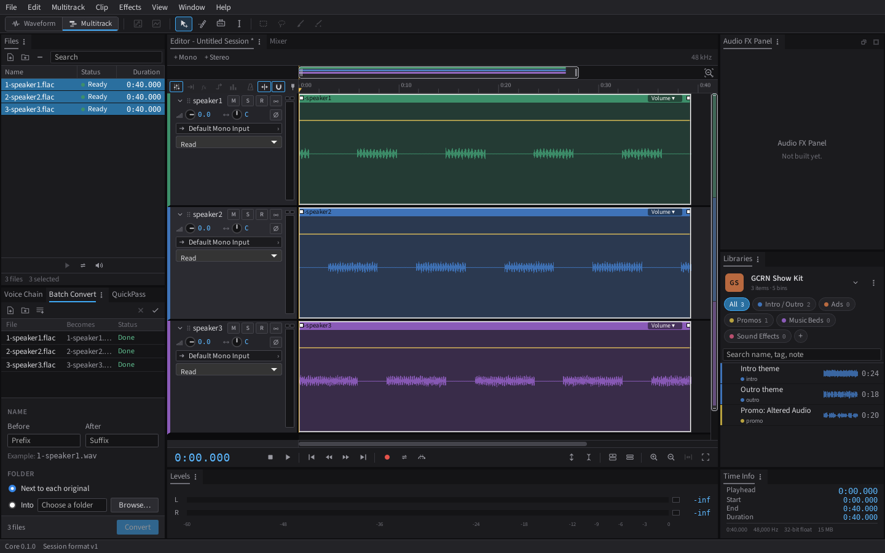
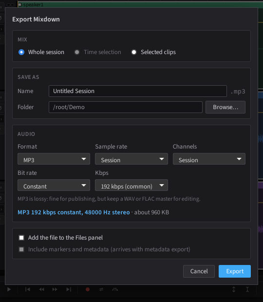

<p align="center">
  <picture>
    <source media="(prefers-color-scheme: light)" srcset="brand/logo/logo-light.png">
    
  </picture>
</p>

<p align="center">
  A free, open-source multitrack audio editor for podcasters and voiceover, from The GeekCast Radio Network.
</p>

It follows the editing workflow that experienced audio editors already know, with its own original design, then adds tools built for podcast production.

> Status: in active development (phase P3, editing). Editing, playback, recording, conversion and mixdown work today. Effects and the Podcast mode tools are still to come. Not ready for production use yet.











## Download

Windows 10 and 11 (64-bit). Get the latest build from the [Releases page](https://github.com/geekcastradio/altered-audio-editor/releases), then pick one file under Assets:

- **`Altered-Audio-Editor-<version>-setup.exe`** is the installer. It adds a Start menu entry and an uninstaller, and works per user or for all users.
- **`Altered-Audio-Editor-<version>-portable.zip`** needs no install. Unzip it anywhere, including a USB drive, and run the app.
- **`SHA256SUMS.txt`** lists a checksum for each file so you can confirm your download is intact.

The app is not code signed yet, so Windows SmartScreen may say it does not recognize it. Choose More info, then Run anyway. Builds are made by GitHub Actions from the tagged source, so what you download matches what is in this repository.

Early versions are pre-releases. Expect rough edges and keep backups of your recordings.

## What it does today

- **Multitrack editing:** move, razor, slip and time-selection tools; trim, split, merge, loop and copy clips; fades and crossfades; clip volume and pan envelopes; markers; ripple delete.
- **Waveform editor:** open any file on its own to cut, silence, amplify and fade it, then save it in place as WAV, FLAC or MP3, or as a new file.
- **Opens what call recorders export:** WAV (including 8-bit and ADPCM), FLAC, MP3, AAC/M4A, ALAC, Ogg Vorbis, Ogg FLAC and Opus. Insert Files as Tracks puts each speaker's file on its own track, straight from the downloaded zip.
- **Spectrum and pitch views:** see frequencies over time, select an unwanted sound (a whistle, a buzz, a chair squeak) with a box, lasso or brush and reduce, remove or repair just that, leaving the voice under it alone. Spot Repair fills a painted click or cough from the audio around it.
- **Recording (early version):** arm tracks, pick each one's input, and record them to their own files while the session plays. On Windows, a "System audio" input records what the computer plays, such as a call, next to your mics.
- **Playback:** live mixing with per-track volume, pan, mute, solo and polarity; Loop Playback and Skip Selection; stereo meters on every track with peak hold and clip lights.
- **Libraries:** keep your show's intros, outros, promos and ads in one place and drag them straight onto tracks.
- **Mixdown and stems:** export the session, a selection or each track as WAV, FLAC or MP3 (constant or variable bit rate) at any sample rate, with a loudness check (LUFS and true peak).
- **Batch Convert:** turn a folder of files into WAV, FLAC or MP3 in one go, with naming, a destination folder and per-file progress.
- **Session templates:** start every episode from your show's track layout.
- **Imports `.sesx` sessions:** brings in tracks, clips and positions from `.sesx` multitrack session files.

## Private by design

- No account and no login. Ever.
- No telemetry, analytics or tracking. The app makes no network calls on its own.
- Update checks are off unless you turn them on.
- Your audio never leaves your computer.

## Support the project

Altered Audio Editor is free. If it helps your show, you can support it at [paypal.me/scp21](https://paypal.me/scp21).

## Contributing

Bug fixes and features are welcome through pull requests. See [CONTRIBUTING.md](CONTRIBUTING.md). Report security problems privately as described in [SECURITY.md](SECURITY.md).

## Build from source (Windows)

First time on this machine? Follow [docs/setup-windows.md](docs/setup-windows.md). It covers installing Rust, Node and the Microsoft build tools step by step.

Then, from the repo folder:

```powershell
npm install
npm run tauri dev
```

## Checks

These are the same checks CI runs. Run them before every commit.

```powershell
npm run check
npm test
npm run build
cd src-tauri
cargo fmt --check
cargo clippy --all-targets -- -D warnings
cargo test
```

## File formats

Every file the app writes is versioned JSON with a `format` and `schema_version` header. Schemas live in [`/schemas`](schemas).

| File | Format id | Extension |
| --- | --- | --- |
| Session | `altaudio.session` | `.altaudio` |
| Library index | `altaudio.library` | `library.json` |
| Session template | `altaudio.template` | `.altemplate` |
| Workspace | `altaudio.workspace` | `.alworkspace` |
| Host voice profile | `altaudio.host_profile` | `.alhost` |
| Keyboard shortcuts | `altaudio.keymap` | `.alkeys` |

## Project docs

- [CLAUDE.md](CLAUDE.md): scope, phase plan, architecture and clean-room rules.
- [docs/decisions.md](docs/decisions.md): architecture decisions log.
- [ATTRIBUTION.md](ATTRIBUTION.md): credits for any adapted third-party code.

## License

Copyright (c) The GeekCast Radio Network, LLC.

Licensed under the GNU General Public License v3.0 or later. See [LICENSE](LICENSE).

"Altered Audio Editor" and its logo are trademarks of The GeekCast Radio Network, LLC and are not covered by the GPL. Forks are welcome under a different name; see [TRADEMARKS.md](TRADEMARKS.md).

All icons and artwork are original. This project is independent and not affiliated with or endorsed by any other software company.
